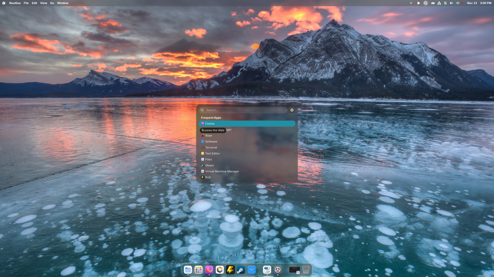
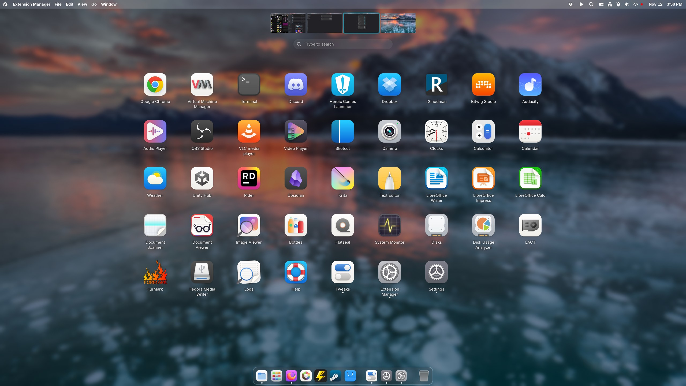
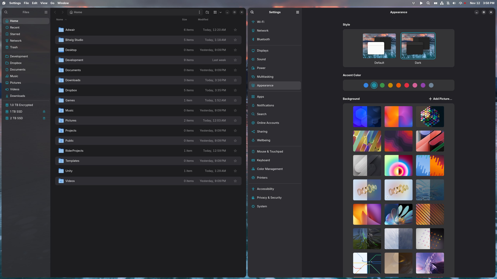
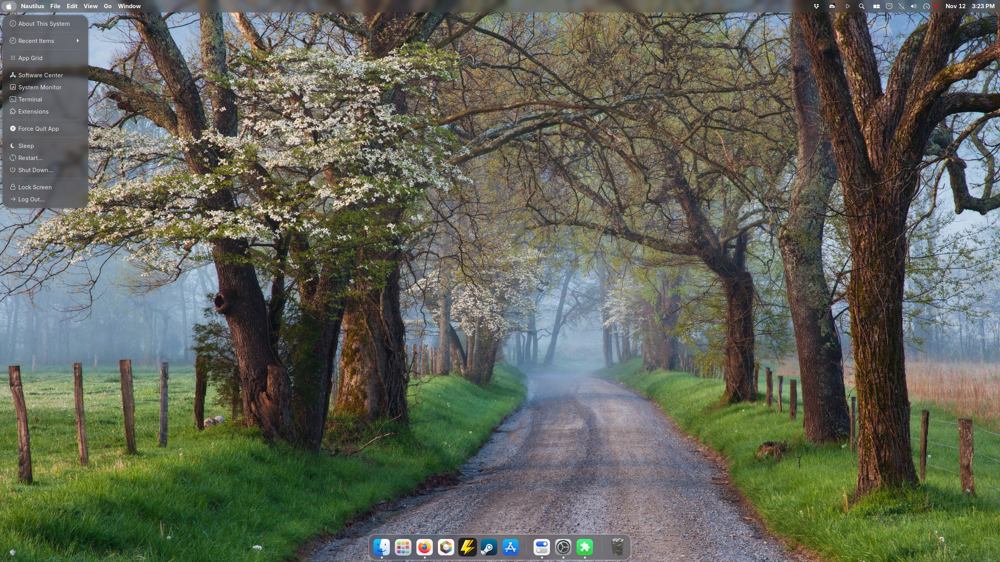
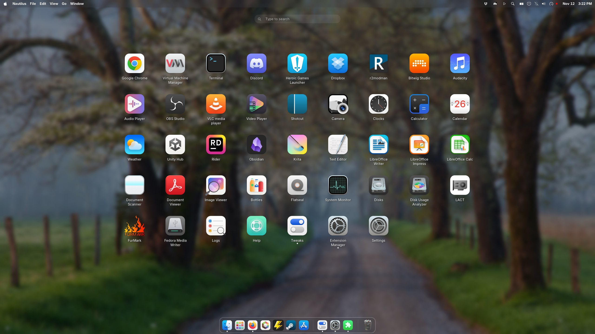
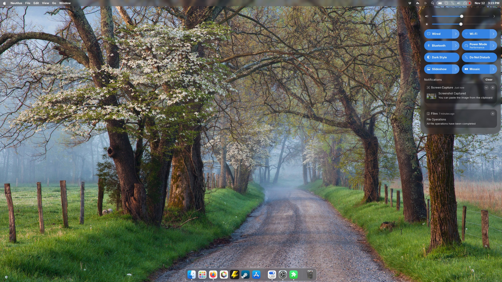
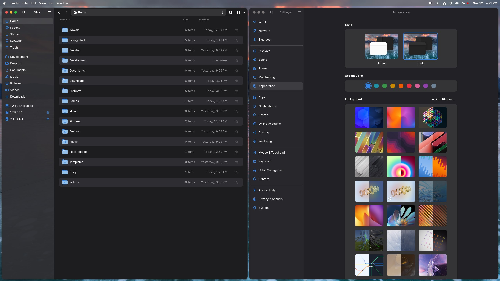

# GNOME Customization Guide

My GNOME desktop customization: keybinds, extensions, and theming. Most settings are shared, and the guide covers two looks: a **Fedora look** built on the Adwair icon theme, and a **macOS look** built on the WhiteSur icon theme. Where a setting differs between the two, it's called out.

For the base system setup (encryption, hardware, apps), see [Fedora Setup](FEDORA_SETUP.md).

## Table of Contents

- [Screenshots](#screenshots)
  - [Fedora Look](#fedora-look)
  - [macOS Look](#macos-look)
- [Custom Keybinds](#custom-keybinds)
- [GNOME Extensions](#gnome-extensions)
  - [Arc Menu](#arc-menu)
  - [Blur My Shell](#blur-my-shell)
  - [Dash to Dock](#dash-to-dock)
  - [Global Menu for GNOME](#global-menu-for-gnome)
  - [Kiwi (is not Apple)](#kiwi-is-not-apple)
  - [Mosaic](#mosaic)
  - [Rounded Window Corners Native](#rounded-window-corners-native)
  - [Status Tray](#status-tray)
  - [Tidy Quick Settings](#tidy-quick-settings)
  - [V-Shell](#v-shell)
  - [Wallpaper Slideshow](#wallpaper-slideshow)
- [Styling](#styling)
  - [Nautilus & Settings Styling](#nautilus--settings-styling)
  - [Icon Themes](#icon-themes)
  - [Sound Theme](#sound-theme)
  - [macOS Window Buttons (Optional)](#macos-window-buttons-optional)
  - [Flatpak Fixes](#flatpak-fixes)

---

## Screenshots

### Fedora Look


*Arc Menu in runner mode, centered on screen and showing frequently used apps.*


*App grid with the Adwair icon theme and V-Shell workspace thumbnails along the top.*


*The accent color carries through Files and Settings thanks to the [Nautilus & Settings styling](#nautilus--settings-styling).*

### macOS Look


*Global Menu for GNOME with the Apple logo, Kiwi dock styling, and Blur My Shell.*


*Launchpad-style app grid with the WhiteSur icon theme and workspace thumbnails hidden.*


*Quick Settings trimmed down with Tidy Quick Settings.*


*The same styling with the blue accent color.*

*Also uses Arc Runner like shown in Fedora look.*

---

## Custom Keybinds

Set these in **Settings → Keyboard → Keyboard Shortcuts**:

| Action       | Shortcut |
|--------------|----------|
| Close window | `Alt+Q`  |
| Hide window  | `Alt+H`  |

How the keybinds work together with [Mosaic](#mosaic):

- With auto-tiling turned off, GNOME's native directional keys still move and split windows.
- Maximize and Restore work in tiling mode.
- `Super+R` enters window resize mode; use the arrow keys to resize, and hold `Shift` to resize in the opposite direction.
- `Super+Enter` enters window management mode.

---

## GNOME Extensions

Install these with [Extension Manager](https://flathub.org/apps/com.mattjakeman.ExtensionManager) (included in the [Fedora Setup](FEDORA_SETUP.md#applications) app list).

### Arc Menu

First, free up `Alt+Space` (GNOME uses it for the window menu by default):

```bash
gsettings set org.gnome.desktop.wm.keybindings activate-window-menu "[]"
```

Settings:

- Disable the Arc Menu Super key override (Arc Menu must not take over the Super key).
- Set the hotkey to `Alt+Space` (Mosaic uses `Super+Enter` for window management).
- Padding: `-1`
- Position in Panel: `2`
- Icon Size: `16`
- Icon: Magnifying glass
- Menu layout: Runner
- Runner position: Center of screen
- Default view: Frequently used apps

### Blur My Shell

- Create a custom pipeline: **"Frosted Glass"** (Dual Kawase blur) with light setting `1.00`. If you'd rather not create one, use the built-in **Default (Light mode)** pipeline instead.
- Set Dock and Popups to **Dynamic**.
- Keep Panel set to **Static**.
- In Panel settings, turn off **Disable in overview**.
- Set every option to use your pipeline (Frosted Glass or Default Light mode).

### Dash to Dock

- Intelligent autohide: Dodge all windows
- Remove the Applications icon
- Disable Show volumes and devices
- Disable keyboard shortcuts (under Behavior)
- Enable Shrink the dash
- Disable Show overview on startup

### Global Menu for GNOME

- Icon: Fedora for the [Fedora look](#fedora-look), or the Apple logo at `22px` for the [macOS look](#macos-look)
- Disable the Help button

Always show the Log Out option:

```bash
gsettings set org.gnome.shell always-show-log-out true
```

**Temporary bug workaround.** This fixes a reported bug and may not be needed on newer versions of the extension:

```bash
cd ~/.local/share/gnome-shell/extensions/globalmenu@ShiroOSL.github.io/
cp menuManager.js menuManager.js.bak
sed -i 's/Clutter\.get_default_backend()/global.stage.context.get_backend()/g' menuManager.js
grep -n "get_backend" menuManager.js
```

### Kiwi (is not Apple)

- Disable Panel Transparency
- Disable Show Panel in Fullscreen on Hover
- Disable Show Window Title
- Move Calendar to the right
- Indicator Style: Accent
- Disable Show Battery %
- Disable Caps Lock and Num Lock icons
- Disable Panel Styling
- Enable Menu App Styling
- Enable Minimize Windows to Dock
- Disable Downloads Folder in Dock (buggy)
- Enable Launchpad Application
- Enable Dock Styling
- Disable everything in the **Buttons** category, unless you want macOS-style window buttons (see [macOS Window Buttons](#macos-window-buttons-optional))
- Disable the entire **Options** category

**Bug fix:** with Blur My Shell enabled, the top panel flashes when entering the overview. Run the following, then log out and back in:

```bash
cd ~/.local/share/gnome-shell/extensions/kiwi@kemma
cp stylesheet.css stylesheet.css.bak
sed -i 's/#panel.kiwi-panel-styled:overview {/#panel.kiwi-panel-styled-disabled:overview {/' stylesheet.css
grep -n "kiwi-panel-styled-disabled" stylesheet.css
```

### Mosaic

- Active hint width: `2`
- Gap width: `2`
- Rebind focus keys to `Alt+Arrow keys`
- Rebind Toggle tiling orientation to `Shift+Super+O`
- Disable Move window (global keybinds)
- Under Resizing, disable every keybind except **Toggle resize mode** (`Super+R`, then arrow keys; hold `Shift` for the opposite direction)
- Leave all other keybinds as they are, so `Super+Alt+Arrow keys` still switches workspaces like stock GNOME

### Rounded Window Corners Native

Install it; no configuration needed. This version builds on GTK4 and is more stable.

### Status Tray

- Icon size: `16px`
- Padding between icons: `16px`
- Panel position: Right

### Tidy Quick Settings

Not available on extensions.gnome.org. Install it manually by following the instructions in the [tidy-quicksettings repo](https://github.com/Soloredis/tidy-quicksettings).

Settings:

- Hide the Power icon
- Hide the Screenshot button
- Hide the Settings button
- Hide the Lock button
- Hide the Power Menu button

### V-Shell

**Layout**

| Setting | Fedora look | macOS look |
|---------|-------------|------------|
| Thumbnails Position / Workspaces Orientation | Top Horizontal | Top Horizontal |
| Workspace Thumbnails Max Scale – App View | `6` | `0` |
| Workspace Thumbnails Max Scale – Search | `6` | `0` |
| Fine Tune Workspace Thumbnails Position | `0` | `0` |

**Appearance**

- Disable Show Wallpaper

**App Grid**

- App Grid Page Width Scale: `70`
- App Grid Page Height Scale: `100`

**Behavior**

- App Grid Animation: Bottom to Top
- Startup State: Desktop
- Workspace Switcher Animation: Default

**Misc**

- Enable Smooth App Grid Animations

### Wallpaper Slideshow

- Set the slideshow directory.
- Set the Bing directory to the same folder as the slideshow.
- Slide duration: 24 hours
- Disable Use Absolute Time Elapsed for Slide Duration
- Sort by: Oldest date

---

## Styling

### Nautilus & Settings Styling

Adds accent-colored sidebar icons, striped list rows, and a translucent Files sidebar. Running it again replaces the previous version instead of duplicating it.

```bash
mkdir -p ~/.config/gtk-4.0
sed -i '/Custom tweaks: begin/,/Custom tweaks: end/d' ~/.config/gtk-4.0/gtk.css 2>/dev/null
cat >> ~/.config/gtk-4.0/gtk.css << 'EOF'
/* Custom tweaks: begin */
/* Blue sidebar icons */
window.nautilus-window placessidebar row box > image:first-child { color: @accent_bg_color; }

/* Accent-colored sidebar icons in other apps, like Settings */
.navigation-sidebar image { color: @accent_bg_color; opacity: 1; }

/* Alternating row stripes in list views, matching the sidebar */
columnview > listview > row:nth-child(even):not(:selected):not(:hover) {
  background-color: @sidebar_bg_color;
}

/* Slightly stronger hover so it stands out from the stripes */
columnview > listview > row:hover:not(:selected) {
  background-color: alpha(currentColor, 0.08);
}

/* Translucent Files sidebar */
.nautilus-window { background-color: transparent; }
.nautilus-window .sidebar-pane { background-color: alpha(@sidebar_bg_color, 0.95); }
.nautilus-window overlay-split-view > widget:not(.sidebar-pane) { background-color: @view_bg_color; }
/* Custom tweaks: end */
EOF
gsettings set org.gnome.desktop.interface accent-color 'blue'
nautilus -q
pkill -f gnome-control-center
```

The script sets the accent to blue, but the styling follows whatever accent you pick in **Settings → Appearance**.

**To remove:**

```bash
sed -i '/Custom tweaks: begin/,/Custom tweaks: end/d' ~/.config/gtk-4.0/gtk.css && gsettings reset org.gnome.desktop.interface accent-color && nautilus -q; pkill -f gnome-control-center
```

### Icon Themes

Pick one, depending on which look you want.

**Fedora look: Adwair**

[Adwair](https://github.com/kusaida/Adwair) by kusaida:

```bash
git clone --depth 1 https://github.com/kusaida/Adwair.git
cd Adwair
chmod +x install.sh
./install.sh
```

**macOS look: WhiteSur**

Download the icon theme from [GNOME Look](https://www.gnome-look.org/p/1405756), then extract it into your local icons folder (the first command creates the folder if it doesn't exist):

```bash
mkdir -p ~/.local/share/icons
tar -xf ~/Downloads/01-WhiteSur.tar.xz -C ~/.local/share/icons/
```

If your download has a different file name, use that instead. You can also extract it with your file manager and move the folder into `~/.local/share/icons` manually.

To match, open the [Global Menu for GNOME](#global-menu-for-gnome) settings, change the icon to the **Apple logo**, and set the icon size to `22px`.

**Apply the theme**

Open **GNOME Tweaks → Appearance → Icons** and select the theme. Alternatively, set it from the terminal (replace `THEME_NAME` with the theme's folder name in `~/.local/share/icons`):

```bash
gsettings set org.gnome.desktop.interface icon-theme 'THEME_NAME'
```

### Sound Theme

I use the Yaru sound theme (from Ubuntu), available in the Fedora repos:

```bash
sudo dnf install yaru-sound-theme
```

Then select **Yaru** as the sound theme in **GNOME Tweaks**, or set it from the terminal:

```bash
gsettings set org.gnome.desktop.sound theme-name 'Yaru'
```

### macOS Window Buttons (Optional)

For macOS-style window buttons, enable Kiwi's **Buttons** category. Leave the defaults, but turn on the Firefox option. Log out and back in to apply.

Extension Manager runs as a Flatpak, so give it read-only access to your GTK4 config and Kiwi's folder:

```bash
flatpak override --user --filesystem=xdg-config/gtk-4.0:ro --filesystem=$HOME/.local/share/gnome-shell/extensions/kiwi@kemma:ro com.mattjakeman.ExtensionManager
```

### Flatpak Fixes

These force the apps to run through XWayland instead of native Wayland.

Prism Launcher:

```bash
flatpak override --user --nosocket=wayland org.prismlauncher.PrismLauncher
```

Obsidian:

```bash
flatpak override --user --nosocket=wayland md.obsidian.Obsidian
```
